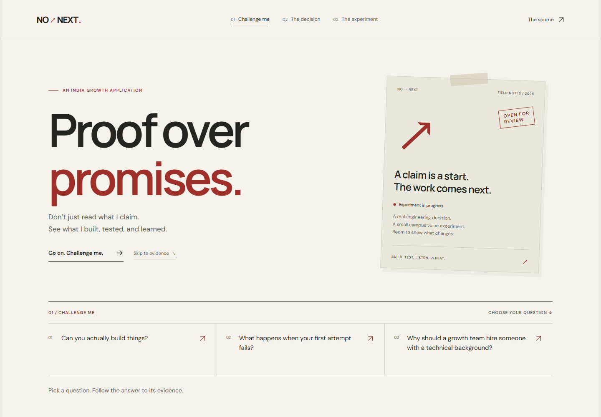
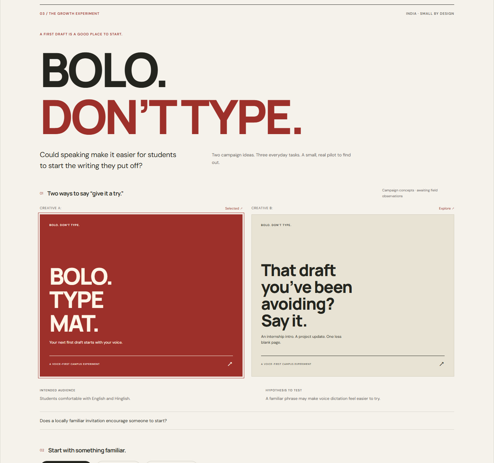

# NO → NEXT

[](https://github.com/Pradhyut21/no-next/actions/workflows/check.yml)
[](https://github.com/Pradhyut21/no-next/actions/workflows/security.yml)

An interactive portfolio that lets a reviewer challenge a claim, inspect one real engineering decision, and follow an India-focused voice campaign from hypothesis to evidence.

The guided route is designed for approximately 90–120 seconds, with optional source material for a closer look. **BOLO. DON'T TYPE.** is the campaign centerpiece: two messages, three familiar student tasks, and explicit denominators for a small adult pilot.

> [!IMPORTANT]
> **The local application is functional; the challenge entry remains incomplete.** The portfolio has been observed in an Emergent preview after the reported import. Real pilot results, genuine Wispr Flow development evidence, and verified final public deployment remain open. The latest signed-out recheck on **31 October 2026** could not reach either Emergent URL, so hosted interaction tests did not execute. See the [dated delivery status](docs/DELIVERY_STATUS.md). Public pilot observations remain unknown; no outcomes are invented.



_Actual local application capture. It is not an Emergent development recording or participant evidence._

## Start here

- [Deliverables index](docs/DELIVERABLES.md): source, setup, verification, evidence and handoff.
- [25-second product showcase](docs/media/no-next-showcase.mp4) · [thumbnail](docs/media/showcase-poster.jpg) · [music credits](docs/media/CREDITS.md).
- [Current delivery status](docs/DELIVERY_STATUS.md): what is observed, what is blocked, and what still needs authentic evidence.

[](https://raw.githubusercontent.com/Pradhyut21/no-next/main/docs/media/no-next-showcase.mp4)

_Actual app-preview captures, edited text and licensed instrumental music. This is a product showcase, with pilot and voice evidence visibly pending. It does not replace the candidate's genuine Flow development recording or personal explanation of using voice._

## Explore the work

| Experience                           | What the reviewer can do                                                                                                     |
| ------------------------------------ | ---------------------------------------------------------------------------------------------------------------------------- |
| **01 · Challenge Me**                | Choose one of three questions and follow a concise answer to its supporting work.                                            |
| **02 · One Decision, Real Evidence** | Make a simulated stale-reading decision, then inspect JalRakshak's actual interface, source, recorded demo, and limitations. |
| **03 · BOLO. DON'T TYPE.**           | Compare two campaign concepts, explore three student tasks, and inspect pilot findings or their honest pending state.        |

The campaign includes the five-stage onboarding teardown and compact **Built Out Loud** log. These remain within the third experience.



## Run locally

Requires **Node 22.18.0** and npm. From the project directory:

```sh
npm ci
npm run dev
```

Open the local URL printed by Vite. For the production build:

```sh
npm run build
npm run preview
```

The app uses React, strict TypeScript, Vite, Zod, and lightweight CSS. Interaction state stays in the browser without persistence. No account, backend, database, API key, microphone feature, or paid service is required.

## Verify the implementation

```sh
npx playwright install chromium
npm run check
```

`check` runs TypeScript, ESLint, Prettier, Vitest, validated production compilation, and Playwright. Individual commands include `typecheck`, `lint`, `format:check`, `test`, `validate:content`, `build`, and `test:e2e`.

**31 October rerun:** the complete local sequence passed again, including **66 Vitest tests and 23 Playwright tests**. See the [delivery verification record](docs/DELIVERY_VERIFICATION.md) for the actual checks and hosted-access limits.

**Recorded local verification:** 66 Vitest tests passed, and 23 Playwright tests passed in Chromium. Coverage includes the full journey, pending/completed/partial/invalid aggregates, keyboard and dialog focus, reduced motion, and 360/390/768/1440px layouts. Automated accessibility scans covered pending and completed campaign states and the evidence drawer. These results do not establish a full accessibility certification, physical-device testing, or a hosted Emergent deployment. See [executed verification](docs/VERIFICATION.md) for the commands, results, fixes, and limits.

Playwright starts a local server when needed. Its report is written to `playwright-report/`; failure traces are written to `test-results/`. GitHub workflow configuration and a successful local run are separate from an actually completed remote workflow.

## GitHub checks

The live badges above link to the actual workflow runs. Engineering CI executes the full check sequence and retains the browser report and production build as artifacts. Security CI audits locked dependencies and runs CodeQL on JavaScript/TypeScript. Dependency review applies to pull requests; Dependabot checks npm and action updates weekly. Actions are pinned to full commit hashes and jobs use explicit permissions.

**31 October dependency audit:** 12 moderate dependency findings are rooted in one upstream minimatch advisory in the development linting stack. Engineering CI and the CodeQL job passed; the full security workflow fails its dependency audit. The patched major is outside the current consumers' supported ranges. See the [open advisory and compatible-update blocker](docs/DEPENDENCY_ADVISORY.md), actual workflow output and [security and privacy](SECURITY.md). The older clean audit was time-specific. A repository build artifact is not the required public Emergent deployment.

## Evidence that is ready, and evidence still needed

**Ready:** genuine attributed JalRakshak screenshots, a real interface demonstration, pinned source references, documented review/revisions, explicit simulation labels, and a tested application that exposes its uncertainty.

**Pending:** the actual 10–15-adult convenience pilot, its achieved sample size and feedback, observed onboarding friction, personal voice clips, a real Flow demonstration, original Flow-to-Emergent development recordings, and signed-out verification of the final public Emergent URL. The 10–15 figure is a recruitment target. The shipped aggregate file contains null observations, not measured zero-result findings.

JalRakshak's existing video uses fictional tank data and synthetic narration. It is project evidence, not Wispr Flow development proof. Importing this code also does not establish genuine voice-led work: substantive construction, revision, and verification must occur inside the new Emergent project using actual Wispr Flow dictation. The [Emergent handoff](docs/EMERGENT_HANDOFF.md) contains the supported import-at-creation route and short spoken-friendly instructions.

## Maintain truthful content

| Content                                       | Source                                                                                   |
| --------------------------------------------- | ---------------------------------------------------------------------------------------- |
| Public aggregate pilot observations           | [`pilot-results.json`](src/content/pilot-results.json)                                   |
| Project facts and source references           | [`projects.ts`](src/content/projects.ts), [evidence manifest](docs/EVIDENCE_MANIFEST.md) |
| Challenge responses                           | [`challenges.ts`](src/content/challenges.ts)                                             |
| Campaign concepts and onboarding observations | [`campaign.ts`](src/content/campaign.ts)                                                 |
| Genuine recordings and development log        | [`voice-evidence.ts`](src/content/voice-evidence.ts)                                     |

The strict data contract keeps unknown, observed zero, and unavailable results distinct. Rates show raw fractions alongside percentages. Usability and reuse use **Yes / (Yes + No)**; “Not asked” is excluded. Impossible known totals and participant-level fields are rejected. Invalid runtime content shows an unavailable state.

Recordings need accurate transcripts, video captions, and permitted local files. Validation checks their metadata and file references; it cannot prove that an event occurred. Preserve originals and record only actual activity.

Keep the private workbook, contact information, private messages, and participant dictation out of the repository. Publish reviewed aggregates and anonymized themes only. Synthetic cohorts are confined to automated tests; there is no public fixture mode. Fonts are self-hosted and no analytics SDK is included.

## Review and handoff documents

- [Deliverables index](docs/DELIVERABLES.md)
- [Current delivery status](docs/DELIVERY_STATUS.md)
- [Contribution and evidence-update workflow](CONTRIBUTING.md)
- [Requirement-by-requirement audit](docs/REQUIREMENTS_AUDIT.md)
- [Architecture and behavior](docs/PROJECT_SPEC.md)
- [Pilot data dictionary](docs/PILOT_DATA_DICTIONARY.md)
- [Evidence provenance](docs/EVIDENCE_MANIFEST.md)
- [Executed verification](docs/VERIFICATION.md)
- [Emergent handoff](docs/EMERGENT_HANDOFF.md)
- [Release checklist](docs/RELEASE_CHECKLIST.md)
- [Build 1 delivery record](docs/BUILD1_REPORT.md)

Source screenshots retain their original MIT notice. Font licenses are included beside their assets. Repository checks make engineering work inspectable; selection depends on the complete application and its genuine evidence.
