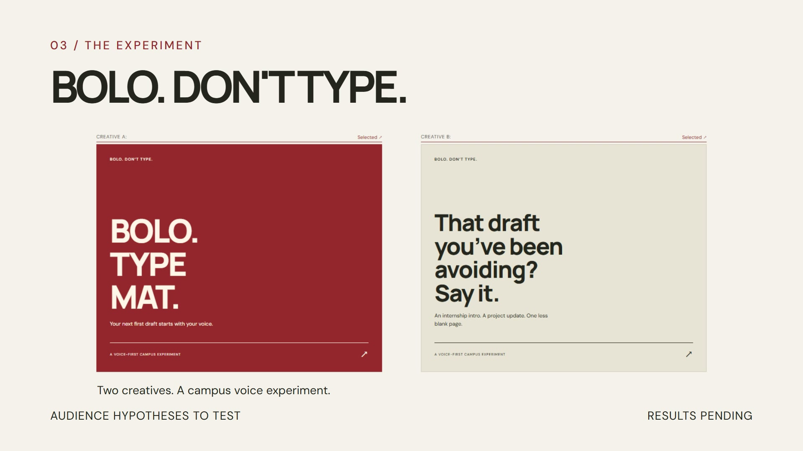

# Deliverables

Start with the [current delivery status](DELIVERY_STATUS.md) and [31 October verification](DELIVERY_VERIFICATION.md). They separate verified local engineering, hosted observations, and missing authentic evidence. A working local application, passing repository checks, or a showcase film does not establish completion of the hiring challenge.

## Application and engineering evidence

| Deliverable                              | Location                                                                                                | Scope                                                                                                                |
| ---------------------------------------- | ------------------------------------------------------------------------------------------------------- | -------------------------------------------------------------------------------------------------------------------- |
| Runnable application and setup           | [Repository README](../README.md), [`src/`](../src), [`package.json`](../package.json)                  | Three interactive experiences, validated aggregate results, accessible evidence drawer, and explicit pending states. |
| Architecture and behavior                | [Project specification](PROJECT_SPEC.md)                                                                | Presentation, factual content, deterministic calculations, and media manifests.                                      |
| Pilot data contract                      | [Data dictionary](PILOT_DATA_DICTIONARY.md), [public aggregate file](../src/content/pilot-results.json) | Reviewed public aggregates only; unknown and observed zero remain distinct.                                          |
| Source provenance                        | [Evidence manifest](EVIDENCE_MANIFEST.md)                                                               | Attributed JalRakshak screenshots, pinned source links, recorded demonstration, and claim limitations.               |
| Recorded local verification              | [Verification record](VERIFICATION.md)                                                                  | Dated executed checks and their limits. Historical results are not claims about a new deployment.                    |
| Remote verification                      | [GitHub Actions](https://github.com/Pradhyut21/no-next/actions)                                         | Inspect the run and commit before describing current CI or security checks as passed.                                |
| Requirements and release gates           | [Requirements audit](REQUIREMENTS_AUDIT.md), [release checklist](RELEASE_CHECKLIST.md)                  | Implemented capability remains separate from fieldwork, genuine recordings, and submission completion.               |
| Emergent transfer and genuine voice work | [Emergent handoff](EMERGENT_HANDOFF.md)                                                                 | Import instructions, short spoken-friendly tasks, actual change review, and verification requirements.               |
| Original local delivery record           | [Build 1 report](BUILD1_REPORT.md)                                                                      | Historical implementation, run instructions, verification, and missing evidence.                                     |

## Edited product showcase

- [Download the MP4](media/no-next-showcase.mp4): 25 seconds, 1920 × 1080, 30fps; actual app-preview captures with animated text and instrumental music.
- [Poster](media/showcase-poster.jpg).
- [Music and sound credits](media/CREDITS.md): retain the attribution when uploading or sharing the film.
- [Technical export verification](media/showcase-verification.json): file hash, frame count, duration, audio presence, and decode results.

The film visibly labels the simulated decision and pending pilot/voice evidence. It contains no candidate narration or genuine Flow dictation. It is a **product showcase**, not the challenge's authentic development recording or proof of participant outcomes. Its screenshots show the captured preview; they do not establish that a later public deployment works.

## Evidence-dependent deliverables

Real pilot findings, original Flow-to-Emergent work recordings, verified public Emergent behavior, and the final evidence-based submission remain governed by the [delivery status](DELIVERY_STATUS.md) and [release checklist](RELEASE_CHECKLIST.md). Do not fill these gaps with synthetic cohorts, the JalRakshak demonstration's synthetic narration, or this showcase.

Private form answers and working submission drafts are deliberately outside the public repository. No private contact information or participant workbook is distributed here.

For future changes, follow [CONTRIBUTING.md](../CONTRIBUTING.md).
